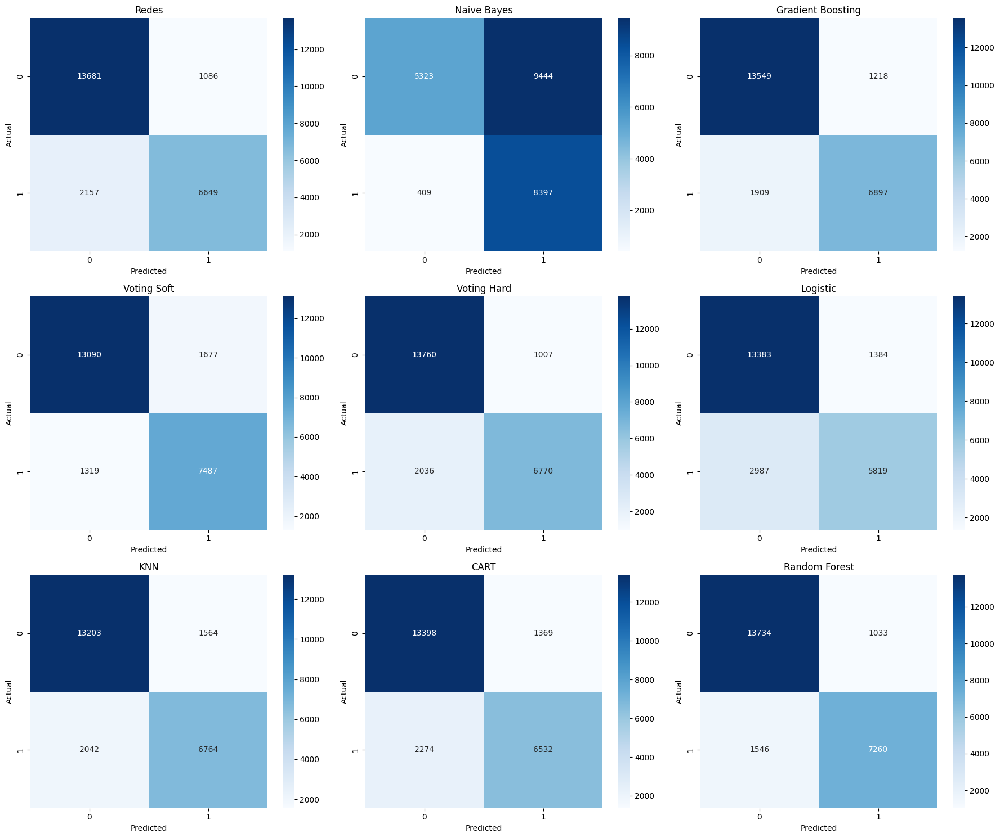
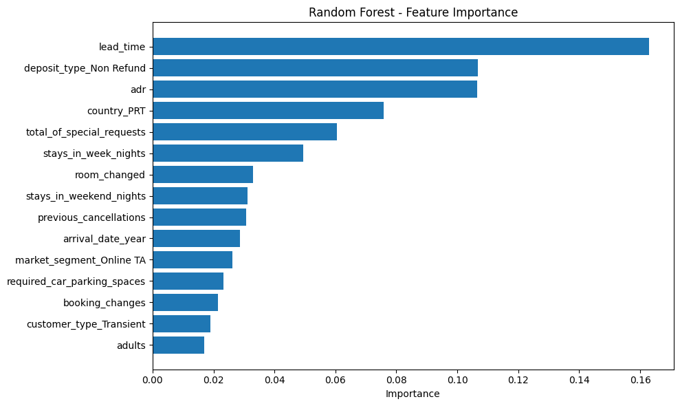
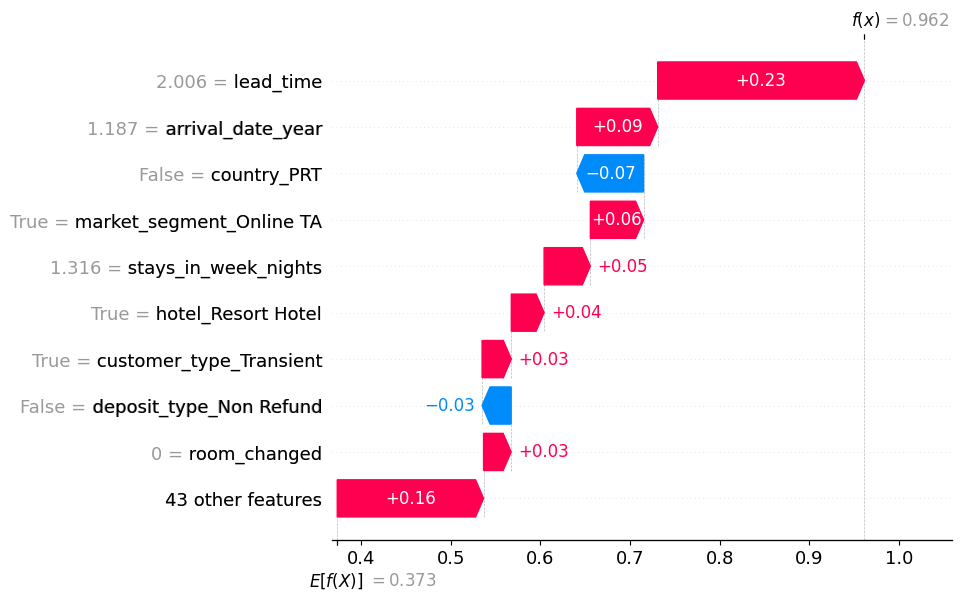

# Predicción de cancelaciones hoteleras

**Machine Learning aplicado a la predicción de cancelaciones de reservas.**

Proyecto académico desarrollado por **Isabel Alonso Casas** y **Bibiana Dorado Mateos** para la asignatura *Machine Learning I: Fundamentos y Aprendizaje Supervisado*, en la Universidad Pontificia Comillas — ICAI.

El proyecto analiza reservas hoteleras, compara nueve modelos o combinaciones de clasificación e interpreta sus predicciones. El objetivo es estudiar qué características se asocian con las cancelaciones y cómo podrían ayudar a gestionar la ocupación y los ingresos del hotel.

En los resultados guardados en el notebook, **Random Forest obtiene un 89,06 % de acierto y un ROC-AUC de 0,9559**, los mejores valores de estas métricas entre los modelos comparados.

**Tecnologías:** Python · pandas · NumPy · Matplotlib · Seaborn · scikit-learn · SHAP · Jupyter

[Ver notebook](codigo_final.ipynb) · [Leer informe final](docs/informe-final.pdf) · [Ver propuesta inicial](docs/propuesta.pdf)

## Datos

Se utiliza el conjunto **Hotel Booking Demand**, incluido en `hotel_bookings.csv`:

| Característica | Valor |
| --- | --- |
| Reservas originales | 119.390 |
| Columnas originales | 32 |
| Reservas canceladas | 44.224 — 37,04 % |
| Variable objetivo | `is_canceled`: 1 = cancelada; 0 = no cancelada |
| Reservas tras la limpieza | 117.863 |
| Variables de entrada tras la codificación | 52 |
| División de datos | 80 % entrenamiento y 20 % prueba, estratificada |

Las variables describen aspectos como la antelación de la reserva, el tipo de hotel, las noches de estancia, el precio medio diario, el depósito y las peticiones especiales.

**Fuentes del dataset:** [Hotel Booking Demand en Kaggle](https://www.kaggle.com/datasets/jessemostipak/hotel-booking-demand) y el artículo original de Nuno Antonio, Ana de Almeida y Luis Nunes, [*Hotel booking demand datasets*](https://doi.org/10.1016/j.dib.2018.11.126), publicado en *Data in Brief* en 2019.

## Proceso de trabajo

1. **Análisis exploratorio:** estructura, valores ausentes, distribución de las cancelaciones, variables categóricas y correlaciones.
2. **Limpieza:** eliminación de identificadores `agent` y `company`, registros incompletos, reservas inconsistentes y valores anómalos de `adr`.
3. **Preparación:** creación de `room_changed`, agrupación de países, codificación de categorías y estandarización de variables numéricas con el escalador ajustado en entrenamiento. Se excluyen `reservation_status` y `reservation_status_date` de las entradas del modelo.
4. **Modelado:** entrenamiento y ajuste de hiperparámetros mediante validación cruzada en varios de los algoritmos.
5. **Evaluación:** comparación de acierto, precisión, sensibilidad, F1, especificidad y ROC-AUC, junto con matrices de confusión.
6. **Interpretación:** importancia de variables, importancia por permutación, gráficos de dependencia parcial y explicaciones SHAP.

## Resultados

Valores procedentes de la tabla comparativa guardada en `codigo_final.ipynb`. La sensibilidad y F1 corresponden a la clase positiva: **reserva cancelada**.

| Modelo | Acierto | Sensibilidad | F1 | ROC-AUC |
| --- | ---: | ---: | ---: | ---: |
| **Random Forest** | **89,06 %** | 82,44 % | **0,8492** | **0,9559** |
| Voting Soft | 87,29 % | 85,02 % | 0,8333 | 0,9414 |
| Voting Hard | 87,09 % | 76,88 % | 0,8165 | — |
| Gradient Boosting | 86,73 % | 78,32 % | 0,8152 | 0,9423 |
| Red neuronal MLP | 86,24 % | 75,51 % | 0,8039 | 0,9397 |
| K vecinos más próximos — KNN | 84,70 % | 76,81 % | 0,7895 | 0,9164 |
| Árbol de decisión — CART | 84,55 % | 74,18 % | 0,7819 | 0,9208 |
| Regresión logística | 81,46 % | 66,08 % | 0,7270 | 0,8972 |
| Naive Bayes gaussiano | 58,20 % | **95,36 %** | 0,6302 | 0,8281 |

El notebook no calcula ROC-AUC para Voting Hard. Random Forest se selecciona por su combinación de acierto, F1 y ROC-AUC; Naive Bayes detecta una mayor proporción de cancelaciones, aunque genera más falsos positivos.

<details>
<summary>Ver las matrices de confusión de los nueve modelos</summary>



</details>

## Interpretación de Random Forest

Según la importancia de variables del modelo, destacan `lead_time` —antelación de la reserva—, el depósito no reembolsable, `adr` —precio medio diario— y el indicador de país `country_PRT`.



También se incluyen explicaciones SHAP para una reserva concreta y para una muestra de diez reservas. El siguiente gráfico muestra cómo las variables contribuyen a la predicción de una observación:



Estas explicaciones describen el comportamiento del modelo y las asociaciones aprendidas a partir de los datos; no establecen relaciones causales.

## Contenido del repositorio

| Archivo o carpeta | Contenido |
| --- | --- |
| [codigo_final.ipynb](codigo_final.ipynb) | Notebook con código, análisis, resultados y gráficos guardados |
| [hotel_bookings.csv](hotel_bookings.csv) | Dataset utilizado por el notebook |
| [requirements.txt](requirements.txt) | Dependencias de Python para trabajar con el proyecto |
| [docs/informe-final.pdf](docs/informe-final.pdf) | Memoria final del trabajo |
| [docs/propuesta.pdf](docs/propuesta.pdf) | Propuesta inicial |
| [docs/img](docs/img) | Gráficos extraídos de las salidas originales del notebook |

## Cómo ejecutarlo

### Requisitos

- **Python 3.11**, versión con la que se creó el notebook original.
- Una terminal y conexión a Internet para instalar las dependencias.
- JupyterLab, incluido en `requirements.txt`.

Para consultar el trabajo, basta con abrir el notebook en GitHub o leer el informe final. Las salidas guardadas permiten revisar los resultados sin volver a entrenar los modelos.

### En Windows

1. Descarga el repositorio desde **Code → Download ZIP** y descomprímelo.
2. Abre una terminal en la carpeta que contiene `codigo_final.ipynb` y `hotel_bookings.csv`.
3. Crea un entorno virtual e instala las dependencias:

   ```bat
   py -3.11 -m venv .venv
   .venv\Scripts\activate.bat
   python -m pip install -r requirements.txt
   ```

   Estos comandos de activación están pensados para **Símbolo del sistema — cmd**.

4. Abre JupyterLab:

   ```bat
   python -m jupyter lab
   ```

5. Abre `codigo_final.ipynb`, selecciona el kernel del entorno `.venv` y ejecuta las celdas en orden, desde el principio.

### En macOS o Linux

Desde la carpeta del proyecto, con Python 3.11 disponible:

```bash
python3.11 -m venv .venv
source .venv/bin/activate
python -m pip install -r requirements.txt
python -m jupyter lab
```

**Mantén el CSV junto al notebook:** el código lo carga con la ruta relativa `hotel_bookings.csv`. Si Jupyter muestra el nombre antiguo del entorno, `mlok`, selecciona el kernel del nuevo entorno virtual.

La ejecución completa puede tardar, especialmente durante las búsquedas de hiperparámetros, los modelos de votación y los cálculos SHAP. `requirements.txt` enumera las dependencias; no fija las versiones exactas del entorno original, por lo que una nueva ejecución puede producir pequeñas diferencias.

## Alcance y posibles mejoras

Este repositorio conserva el notebook, el dataset y los informes originales. Los resultados anteriores proceden de la ejecución guardada en el notebook.

Para ampliar el estudio, se podrían abordar las siguientes mejoras:

- Incorporar el preprocesamiento dentro de un `Pipeline` durante la validación cruzada.
- Elegir el parámetro de poda de CART con validación cruzada o un conjunto de validación independiente: en el notebook actual se compara usando el conjunto de prueba.
- Añadir una evaluación temporal, comprobar qué variables están disponibles en el momento de predecir y ampliar la muestra utilizada para SHAP.
- Ajustar el umbral de decisión según el coste de las cancelaciones no detectadas y de las falsas alarmas.

## Autoras

**Isabel Alonso Casas · Bibiana Dorado Mateos**  
Universidad Pontificia Comillas — ICAI  
Machine Learning I: Fundamentos y Aprendizaje Supervisado
